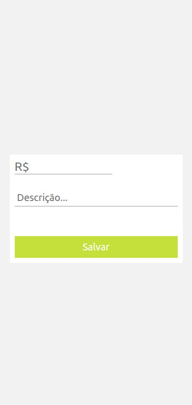

# XPense

Aplicativo mobile para registrar receitas e despesas e acompanhar o saldo pessoal de forma simples.

O XPense foi desenvolvido com React Native e Expo. Os lançamentos ficam armazenados localmente no dispositivo, sem depender de uma API externa.

## Telas do aplicativo

<table>
  <tr>
    <th>Despesas</th>
    <th>Receitas</th>
    <th>Novo lançamento</th>
  </tr>
  <tr>
    <td></td>
    <td></td>
    <td></td>
  </tr>
</table>

## Funcionalidades

- Cadastro de receitas e despesas;
- descrição opcional para cada lançamento;
- atualização automática do saldo;
- separação dos lançamentos por tipo;
- exclusão de lançamentos;
- atualização da lista ao arrastar a tela para baixo;
- persistência local com SQLite e AsyncStorage.

## Tecnologias

- React Native;
- Expo SDK 36;
- React Navigation;
- Styled Components;
- Expo SQLite;
- AsyncStorage.

## Como executar

Este projeto usa o Expo SDK 36 e dependências da época em que foi criado. Para evitar incompatibilidades, utilize um ambiente legado compatível, como Node.js 12.x, Yarn Classic e Expo CLI 3.x.

```bash
git clone https://github.com/ThiagoNelsi/Personal-Expense-Manager.git
cd Personal-Expense-Manager/mobile
yarn install
yarn start
```

Com o servidor do Expo aberto, execute o aplicativo em um emulador ou dispositivo compatível. Também é possível iniciar diretamente por plataforma:

```bash
# Android
yarn android

# iOS (requer macOS)
yarn ios
```

> O Expo SDK 36 é legado. Ambientes e versões atuais do Expo podem exigir a atualização das dependências antes de executar o projeto.

## Estrutura do projeto

```text
mobile/
├── assets/                 # Ícone e splash screen
├── src/
│   ├── context/            # Estado compartilhado da aplicação
│   ├── pages/              # Telas e componentes visuais
│   └── services/           # Persistência com SQLite e AsyncStorage
├── App.js                  # Navegação e inicialização do app
├── app.json                # Configuração do Expo
└── package.json            # Scripts e dependências
```

## Armazenamento

As receitas e despesas são salvas em tabelas SQLite no próprio dispositivo. O saldo é mantido no AsyncStorage e atualizado ao criar ou excluir um lançamento.
